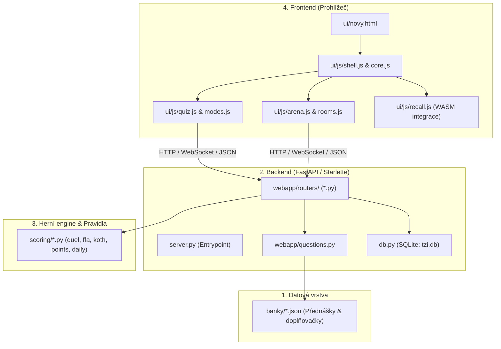

# 📘 TZI Trenér: Kompletní průvodce architekturou a vývojem

Tento dokument slouží jako tvá hlavní mapa celého projektu po refaktoru. Všechny klíčové komponenty, toky dat i konkrétní soubory máš popsané níže s přímými odkazy.

---

## 🧭 Rychlá navigace
1. [Přehled architektury (4 vrstvy)](#-1-přehled-architektury-4-vrstvy)
2. [Vrstva 1: Data a banky otázek](#-2-vrstva-1-data-a-banky-otázek)
3. [Vrstva 2: Backend & API (Python)](#-3-vrstva-2-backend--api-python)
4. [Vrstva 3: Herní mechaniky & Scoring (Python)](#-4-vrstva-3-herní-mechaniky--scoring-python)
5. [Vrstva 4: Frontend & UI (HTML + Vanilla JS)](#-5-vrstva-4-frontend--ui-html--vanilla-js)
6. [Záhada WASM vyřešena: Proč tu je a jak s ním pracovat](#-6-záhada-wasm-vyřešena)
7. [Kuchařka vývojáře: Jak udělat běžné úpravy](#-7-kuchařka-vývojáře-běžné-scénáře)

---

## 🧱 1. Přehled architektury (4 vrstvy)



---

## 📂 2. Vrstva 1: Data a banky otázek

Všechna data otázek jsou uložena jako statické JSON soubory. Žádná magie.

- **Umístění**:
  - [`banky/`](file:///home/richieee/TZI-TIN-APP/banky/) – JSONy přednášek (`01-2026-10-01.json`, `02-2026-10-08.json`...).
  - [`banky/doplnovacka/`](file:///home/richieee/TZI-TIN-APP/banky/doplnovacka/) – Otázky na doplňování přesných termínů.
- **Generátory**:
  - [`scripts/build_bank.py`](file:///home/richieee/TZI-TIN-APP/scripts/build_bank.py) a další v [`scripts/`](file:///home/richieee/TZI-TIN-APP/scripts/) – jednorázové skripty pro převod surových poznámek do JSONu.
- **Struktura otázky typu choice**:
  ```json
  {
    "id": "1-1",
    "type": "choice",
    "number": 1,
    "text": "Která z uvedených soustav je nepoziční?",
    "options": {
      "A": "dvojková",
      "B": "římská",
      "C": "šestnáctková",
      "D": "osmičková"
    },
    "correct": ["B"],
    "explanation": "Nepoziční soustava nemá základ..."
  }
  ```

---

## 🐍 3. Vrstva 2: Backend & API (Python)

Backend běží na FastAPI / Starlette serveru. Dříve to byl jeden obří skript, nyní je logicky rozdělen:

- [`server.py`](file:///home/richieee/TZI-TIN-APP/server.py): Vstupní bod aplikace, startuje Uvicorn server a sestavuje routery.
- [`db.py`](file:///home/richieee/TZI-TIN-APP/db.py): Jednoduchá vrstva nad SQLite (`tzi.db`), ukládá uživatele, relace a skóre.
- [`webapp/config.py`](file:///home/richieee/TZI-TIN-APP/webapp/config.py): Konfigurace (porty, tajné klíče, debug módy).
- [`webapp/questions.py`](file:///home/richieee/TZI-TIN-APP/webapp/questions.py): Načítání a servírování JSONů ze složky `banky/`.
- [`webapp/routers/`](file:///home/richieee/TZI-TIN-APP/webapp/routers/): Konkrétní endpointy:
  - [`auth.py`](file:///home/richieee/TZI-TIN-APP/webapp/routers/auth.py) – přihlášení, registrace, session cookies.
  - [`study.py`](file:///home/richieee/TZI-TIN-APP/webapp/routers/study.py) – endpointy pro běžné procvičování.
  - [`competitive.py`](file:///home/richieee/TZI-TIN-APP/webapp/routers/competitive.py) – lobby, multiplayer místnosti, WebSocket komunikace.
  - [`account.py`](file:///home/richieee/TZI-TIN-APP/webapp/routers/account.py) – profil uživatele, statistiky.

---

## 🏆 4. Vrstva 3: Herní mechaniky & Scoring (Python)

Čistá byznys logika bez závislostí na HTTP nebo webu. Sídlí v balíčku [`scoring/`](file:///home/richieee/TZI-TIN-APP/scoring/):

- [`scoring/constants.py`](file:///home/richieee/TZI-TIN-APP/scoring/constants.py): Konstanty pro bodování, časové limity, násobiče.
- [`scoring/points.py`](file:///home/richieee/TZI-TIN-APP/scoring/points.py): Výpočet bodů podle rychlosti a správnosti.
- [`scoring/rooms.py`](file:///home/richieee/TZI-TIN-APP/scoring/rooms.py): Správa stavu herních místností v paměti.
- [`scoring/duel.py`](file:///home/richieee/TZI-TIN-APP/scoring/duel.py): Pravidla módu 1v1 Duel.
- [`scoring/ffa.py`](file:///home/richieee/TZI-TIN-APP/scoring/ffa.py): Pravidla Free-For-All arény.
- [`scoring/koth.py`](file:///home/richieee/TZI-TIN-APP/scoring/koth.py): Pravidla módu King of the Hill.
- [`scoring/daily.py`](file:///home/richieee/TZI-TIN-APP/scoring/daily.py): Logika denních výzev a rotace otázek.
- [`scoring/leaderboard.py`](file:///home/richieee/TZI-TIN-APP/scoring/leaderboard.py): Počítání a řazení žebříčků.

---

## 💻 5. Vrstva 4: Frontend & UI (HTML + Vanilla JS)

Frontend nevyužívá žádný obří framework ani build proces (Webpack/Vite). Je to modulární **Vanilla JS** přímo načítaný v prohlížeči.

- **Vstupní stránka**:
  - [`ui/novy.html`](file:///home/richieee/TZI-TIN-APP/ui/novy.html): Kompletní rozhraní (Single Page layout s taby/přepínači).
- **Styly**:
  - [`ui/css/`](file:///home/richieee/TZI-TIN-APP/ui/css/) – CSS rozdělené podle komponent.
- **JavaScript moduly ([`ui/js/`](file:///home/richieee/TZI-TIN-APP/ui/js/))**:
  - [`core.js`](file:///home/richieee/TZI-TIN-APP/ui/js/core.js) – globální stav, helpery, event bus.
  - [`shell.js`](file:///home/richieee/TZI-TIN-APP/ui/js/shell.js) – navigace mezi obrazovkami, modální okna.
  - [`quiz.js`](file:///home/richieee/TZI-TIN-APP/ui/js/quiz.js) – zobrazení otázky, klikání na A/B/C/D, renderování vysvětlení.
  - [`modes.js`](file:///home/richieee/TZI-TIN-APP/ui/js/modes.js) – ovládání singleplayer módů (maraton, náhodný výběr).
  - [`arena.js`](file:///home/richieee/TZI-TIN-APP/ui/js/arena.js) & [`rooms.js`](file:///home/richieee/TZI-TIN-APP/ui/js/rooms.js) – multiplayer aréna a místnosti.
  - [`gamification.js`](file:///home/richieee/TZI-TIN-APP/ui/js/gamification.js) – odznaky, streak, zvuky, animace bodů.
  - [`recall.js`](file:///home/richieee/TZI-TIN-APP/ui/js/recall.js) – specifická logika pro doplňovačky.

---

## ⚡ 6. Záhada WASM vyřešena

### K čemu to slouží?
Při doplňovačce student napíše např. *"asociativní zákon"*, ale v testu je *"asociativnost"*, nebo udělá drobný překlep.
WASM dělá dvě věci:
1. Odstraní diakritiku a převede na malá písmena.
2. Vypočítá Levenshteinovu vzdálenost (toleruje 1 překlep).

### Jak to funguje pod kapotou?
- [`wasm/quiz_core.ts`](file:///home/richieee/TZI-TIN-APP/wasm/quiz_core.ts): Zdrojový kód v AssemblyScriptu (TypeScript dialekt).
- Výsledná binárka je vložená jako base64 řetězec přímo v [`ui/js/recall.js`](file:///home/richieee/TZI-TIN-APP/ui/js/recall.js#L10).
- **Tvůj přístup**: Do `wasm/quiz_core.ts` **nemusíš vůbec sahat**. Pokud nepotřebuješ měnit algoritmus tolerance překlepů, ber to jako hotovou knihovnu.

---

## 🛠️ 7. Kuchařka vývojáře: Běžné scénáře

### Scénář A: Chci přidat novou otázku nebo přednášku
1. Otevři existující soubor v [`banky/`](file:///home/richieee/TZI-TIN-APP/banky/) (např. `01-2026-10-01.json`).
2. Přidej nový JSON objekt do pole `"questions"`.
3. Ulož soubor. Server změnu ihned načte bez nutnosti restartu.

### Scénář B: Chci upravit bodování za rychlou odpověď
1. Otevři [`scoring/points.py`](file:///home/richieee/TZI-TIN-APP/scoring/points.py) a [`scoring/constants.py`](file:///home/richieee/TZI-TIN-APP/scoring/constants.py).
2. Uprav výpočetní vzorec nebo bodové konstanty.
3. Spusť testy ověření: `pytest tests/test_features.py`.

### Scénář C: Chci upravit vzhled nebo chování kvízové otázky
1. **HTML prvky**: Najdi odpovídající kartu v [`ui/novy.html`](file:///home/richieee/TZI-TIN-APP/ui/novy.html).
2. **Logika kliknutí / vykreslení**: Otevři [`ui/js/quiz.js`](file:///home/richieee/TZI-TIN-APP/ui/js/quiz.js).
3. **Styl**: Najdi pravidlo v [`ui/css/`](file:///home/richieee/TZI-TIN-APP/ui/css/).

### Scénář D: Spuštění serveru pro vývoj
V kořeni `/home/richieee/TZI-TIN-APP` spusť:
```bash
python3 server.py
```
A v prohlížeči otevři `http://localhost:8000`.
